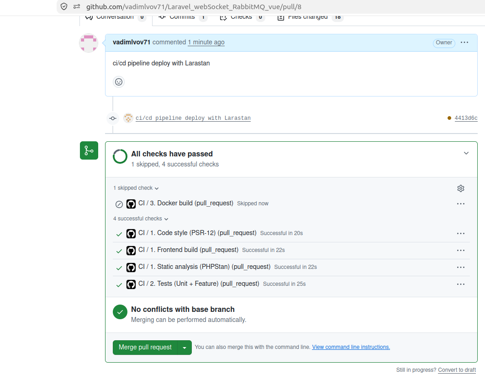

<p align="center"><a href="https://laravel.com" target="_blank"></a></p>

<p align="center">
<a href="https://github.com/vadimlvov71/Laravel_webSocket_RabbitMQ_vue/actions/workflows/ci.yml"></a>
<a href="https://packagist.org/packages/laravel/framework"></a>
<a href="https://packagist.org/packages/laravel/framework"></a>
<a href="https://packagist.org/packages/laravel/framework"></a>
</p>

## Содержание

- [Демо: живые обновления через WebSocket](#демо-живые-обновления-через-websocket)
- [Поиск (Elasticsearch)](#поиск-elasticsearch)
- [REST API](#rest-api)
- [CI/CD](#cicd)

## Документация

| Документ | О чём |
|---|---|
| 📈 [Масштабирование](docs/wiki/Scaling.md) | План на 1 млн комментариев и 100 тыс. пользователей в сутки: узкие места, кэш, горизонтальное масштабирование, порядок работ |
| 📘 [REST API (OpenAPI)](http://localhost:8086/docs/api) | Интерактивная документация API, открывается при запущенном проекте |
| 🤝 [Как вносить изменения](CONTRIBUTING.md) | Ветки, сообщения коммитов (Conventional Commits), pull request |

## Демо: живые обновления через WebSocket

```bash
docker compose up -d
docker compose exec app php artisan migrate
docker compose exec app php artisan db:seed --class=CommentSeeder   # 40 веток от 6 демо-авторов
```

1. Откройте http://localhost:8086 в двух окнах: обычном и инкогнито (или в двух браузерах).
2. В первом окне добавьте комментарий или ответьте на существующий.
3. Во втором окне появится уведомление («New comment from …» / «… replied to …»), список обновится, новый комментарий подсветится жёлтым. Кнопка Show прокручивает к нему, а если ветка на другой странице, открывает нужную.
4. Ответьте во втором окне на комментарий из первого: в первом придёт особое уведомление «… replied to your comment».
5. Если окно в фоне, в заголовке вкладки появляется счётчик: «(2) Comments».

Окно автора своё событие не получает (`broadcast(...)->toOthers()` по `X-Socket-ID`), оно обновляет список само после ответа сервера.

Путь события: `POST /comments` → `CommentCreated` → обменник RabbitMQ `comments` → очередь `broadcasts` → воркер `queue` → Reverb → Laravel Echo во всех остальных вкладках → `GET /comments`.

### RabbitMQ

Схема задана в `config/queue.php` (`connections.rabbitmq`) и объявляется командой `php artisan rabbitmq:setup` при старте воркеров:

```
обменник comments (direct) ──routing key = имя очереди──> broadcasts   рассылки в WebSocket, воркер queue
                                                      └──> default      остальные задачи, воркер queue-default
```

Воркеры запущены через `rabbitmq:consume` (подписка `basic_consume`), поэтому в http://localhost:15672 у каждой очереди виден потребитель. Чтобы увидеть сообщение в очереди: `docker compose stop queue`, добавьте комментарий, откройте Queues → broadcasts → Get messages, затем `docker compose start queue`.

После изменения кода событий или задач перезапустите воркер: `docker compose exec app php artisan queue:restart`.

## Поиск (Elasticsearch)

Поле «Search comments…» над таблицей ищет по тексту и имени автора: русская и английская морфология («очередь» найдёт «очереди»), опечатки («коментарий»), начало слова при наборе. Найденные слова подсвечены; клик открывает страницу с веткой и подсвечивает комментарий.

```bash
docker compose exec app php artisan comments:reindex   # создать индекс и загрузить все комментарии
```

- Новые и удалённые комментарии попадают в индекс сами: событие модели → задача `SyncCommentToSearch` → очередь `default` → воркер `queue-default` → Elasticsearch.
- Запросы к Elasticsearch идут через `Http` Laravel (REST API), без отдельного клиента: `App\Services\CommentSearch`.
- Если Elasticsearch не запущен, страница работает, поиск отвечает «Search is temporarily unavailable». Выключить совсем: `ELASTICSEARCH_ENABLED=false`.
- После изменения схемы индекса (`CommentSearch::MAPPING`) выполните `comments:reindex`.

## REST API

`/api/v1`: список, ветка, поиск и создание комментариев (с вложениями, без reCAPTCHA). Доступ по ключам Sanctum с правами `comments:read` / `comments:write`.

```bash
docker compose exec app php artisan migrate
docker compose exec app php artisan api:client-create "Partner" --contact=dev@partner.example   # ключ показывается один раз
curl -H "Authorization: Bearer <token>" http://localhost:8086/api/v1/comments
```

Документация OpenAPI 3.1 с «Try it»: http://localhost:8086/docs/api (спецификация: `/docs/api.json`). Генерируется из кода (Scramble); тесты сверяют каждый ответ API со спецификацией. Ключи: `api:client-list`, `api:client-revoke <id>`.

## CI/CD

При каждом push и pull request GitHub Actions запускает [`.github/workflows/ci.yml`](.github/workflows/ci.yml): стиль кода (Pint), статический анализ (PHPStan), сборку фронтенда, тесты и сборку Docker-образов. Статусы этапов видны у коммита, в pull request и на вкладке [Actions](https://github.com/vadimlvov71/Laravel_webSocket_RabbitMQ_vue/actions).



| Этап | Что проверяет |
|---|---|
| 1. Code style (PSR-12) | `pint --test`, `composer audit` |
| 1. Static analysis (PHPStan) | Larastan, уровень 6 (`phpstan.neon`) |
| 1. Frontend build | `npm run build`, `npm audit --audit-level=high` |
| 2. Tests | `php artisan test` (Unit + Feature, SQLite в памяти) |
| 3. Docker build | сборка образов, только при push в основную ветку |

То же локально:

```bash
docker compose exec -T app ./vendor/bin/pint --test
docker compose exec -T app ./vendor/bin/phpstan analyse --memory-limit=1G
docker compose exec -T app php artisan test
docker compose run --rm -e npm_config_cache=/tmp/.npm node npm run build
```
