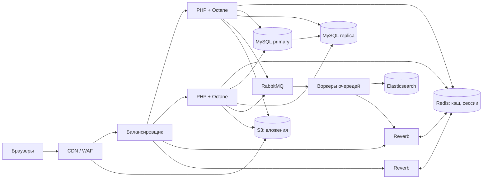

# Масштабирование

Как довести приложение комментариев до нагрузки **1 млн комментариев и 100 тыс. пользователей в сутки**. Это план, а не описание сделанного: что из этого уже есть в коде, сказано явно.

**Вывод.** Нагрузка умеренная: её выдержит один хорошо настроенный сервер с MySQL, Redis и очередями. В текущей архитектуре есть три места, которые сломаются раньше остального. Начинать нужно с них, а не с добавления серверов.

## Содержание

1. [Оценка нагрузки](#1-оценка-нагрузки)
2. [Что сломается первым](#2-что-сломается-первым)
3. [Кэш: точечный сброс](#3-кэш-точечный-сброс)
4. [Горизонтальное масштабирование по слоям](#4-горизонтальное-масштабирование-по-слоям)
5. [Защита и наблюдение](#5-защита-и-наблюдение)
6. [Порядок работ](#6-порядок-работ)

## 1. Оценка нагрузки

| Показатель | Оценка |
|---|---|
| Чтение | 100 тыс. × ~10 просмотров = 1 млн запросов в сутки ≈ **12 rps** в среднем, **100–150 rps** в пике (×10) |
| Запись | если комментарии оставляют 2–5 % посетителей, это 2–5 тыс. в сутки: доли записи в секунду |
| Объём данных | 1 млн × ~1–2 KB ≈ 1–2 GB вместе с индексами, помещается в память MySQL |
| WebSocket | **5–10 тыс.** открытых вкладок одновременно в пике |

Запись почти ничего не стоит. Нагрузку создают чтение и рассылка событий. Шардирование базы и микросервисы не нужны.

## 2. Что сломается первым

### 2.1. Лавина запросов после события WebSocket (самое опасное)

Сейчас каждая открытая вкладка на событие `comment.created` перезапрашивает `GET /comments` ([App.vue](https://github.com/vadimlvov71/Laravel_webSocket_RabbitMQ_vue/blob/main/resources/js/App.vue), `onRemoteComment`). При 10 тыс. вкладок **один** новый комментарий даёт 10 тыс. одновременных запросов, а комментариев тысячи в сутки. К тому же в этот момент кэш только что сброшен.

Решения, по возрастанию сложности:

- **Перезапрашивать список только тем, кому он изменился:** первая страница с сортировкой по дате или открытая ветка. Остальным показывать плашку «Новые комментарии — обновить».
- **Если запрос всё-таки нужен, добавить случайную задержку 0–3 с (jitter),** чтобы запросы не приходили одновременно.
- **Передавать в событии публичные поля комментария** (те, что и так видны в списке) и вставлять его на клиенте без запроса к серверу.

### 2.2. Индексы не подходят под запрос списка

Запрос списка корневых комментариев выглядит так:

```sql
WHERE parent_id IS NULL ORDER BY <поле>, id LIMIT 25 OFFSET ...
```

Сейчас индексы стоят по отдельности на `user_name`, `email` и `created_at`. На миллионе строк MySQL будет сортировать результат в памяти (`Using filesort`). Нужны составные индексы под каждую сортировку:

```php
$table->index(['parent_id', 'created_at', 'id']);
$table->index(['parent_id', 'user_name', 'id']);
$table->index(['parent_id', 'email', 'id']);
// ответы загружаются по ветке
$table->index(['root_id', 'created_at', 'id']);
```

Проверка: `EXPLAIN` не должен показывать `Using filesort`.

### 2.3. `COUNT(*)` и `OFFSET` в пагинации

`paginate()` на каждой странице считает все корневые комментарии. `OFFSET 500000` для дальних страниц читает и отбрасывает полмиллиона строк.

- **Общее количество** держать в кэше или в счётчике, который меняется при создании и удалении комментария.
- **В API перейти на курсорную пагинацию** (`cursorPaginate`, «после id X»): она одинаково быстрая на любой глубине. По правилам API это делается в `/api/v2`.
- **На сайте** номера страниц можно оставить, но ограничить глубину или перейти на «Показать ещё».

## 3. Кэш: точечный сброс

Сейчас любой новый комментарий увеличивает версию в ключе ([CommentCache](https://github.com/vadimlvov71/Laravel_webSocket_RabbitMQ_vue/blob/main/app/Services/CommentCache.php)) и тем самым обесценивает **все** закэшированные страницы. При тысячах комментариев в сутки кэш почти не успевает работать.

Лучше кэшировать в два уровня:

| Уровень | Ключ | Когда сбрасывается |
|---|---|---|
| Списки id корневых комментариев | `roots:{sort}:{dir}:{page}` | только при новом **корневом** комментарии: ответ не меняет состав страниц |
| Ветки | `thread:{root_id}` | новый ответ сбрасывает одну ветку, а не весь кэш |

Страница собирается так: список id корней, затем ветки одним `Cache::many()`.

Дополнительно:

- **Защита от одновременных промахов кэша (cache stampede).** `Cache::flexible()` отдаёт устаревшее значение и обновляет его в фоне. Другой вариант — `Cache::lock()`, чтобы страницу строил только один запрос.
- **Гигантские ветки** (вирусный комментарий с 10 тыс. ответов). Не грузить ветку целиком: отдавать первые N ответов и кнопку «Показать ещё».

## 4. Горизонтальное масштабирование по слоям

Целевая схема:



| Слой | Что сделать |
|---|---|
| **PHP** | Приложение не хранит состояние в процессе: сессии и кэш в Redis. Поэтому можно поставить несколько серверов за балансировщиком. Laravel Octane (FrankenPHP или Swoole) даёт в 3–5 раз больше запросов на тех же серверах. |
| **Файлы** | Локальный диск `public` не годится, как только серверов больше одного. Нужно S3-совместимое хранилище и CDN для вложений и статики. Обработку картинок можно перенести в очередь. |
| **MySQL** | Основной сервер для записи и 1–2 реплики для чтения: `read` и `write` в `config/database.php`, `sticky => true`, чтобы автор сразу видел свой комментарий. Медленные запросы искать через slow query log. |
| **Redis** | Один экземпляр справится. Для отказоустойчивости нужен Sentinel. Кэш и очереди лучше развести по разным базам или экземплярам. |
| **Reverb** | Один процесс держит десятки тысяч соединений, если поднять `ulimit` и установить `ext-uv`. Несколько серверов синхронизируются через Redis (`REVERB_SCALING_ENABLED=true`). WebSocket проксировать через nginx. |
| **RabbitMQ и воркеры** | Очереди уже разделены (`broadcasts` и `default`), воркеры добавляются копиями сервисов. Для отказоустойчивости брокера нужен кластер с quorum queues. |
| **Elasticsearch** | Для 1 млн документов хватит одного узла. Для отказоустойчивости — 3 узла с репликами. Индексация уже идёт через очередь (`SyncCommentToSearch`). |

## 5. Защита и наблюдение

- **Ограничение частоты запросов** на уровне nginx или CDN (по IP), ещё до PHP. Лимиты на запись в приложении и reCAPTCHA уже есть.
- **CDN или WAF перед сайтом:** отдают статику и вложения и отсекают часть атак, в том числе DDoS.
- **Наблюдение.** Pulse уже подключён. Telescope в продакшене выключить: он пишет каждый запрос в MySQL. Собирать метрики времени ответа (p95/p99), глубины очередей и доли попаданий в кэш.
- **Нагрузочное тестирование** (k6 или Locust) по сценарию «читатели + авторы + 10 тыс. WebSocket-клиентов» на копии с 1 млн комментариев. Без замеров любая оптимизация из этой страницы остаётся догадкой.

## 6. Порядок работ

| Этап | Что | Когда |
|---|---|---|
| 1 | Составные индексы, остановка лавины запросов после WebSocket, кэш общего количества, Telescope выключен в продакшене | сразу: дёшево и даёт больше всего эффекта |
| 2 | Seeder на 1 млн комментариев и нагрузочный тест | до любых дальнейших изменений |
| 3 | Двухуровневый кэш (списки id и ветки), `Cache::flexible` | если тест показал промахи кэша |
| 4 | Вложения в S3 + CDN, Octane | перед вторым сервером |
| 5 | Реплики MySQL, несколько серверов PHP и Reverb | только если замеры покажут необходимость |

Этапы 1 и 2 займут несколько дней. Скорее всего, после них один сервер выдержит заданную нагрузку с запасом.
